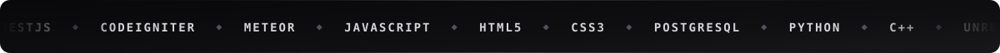
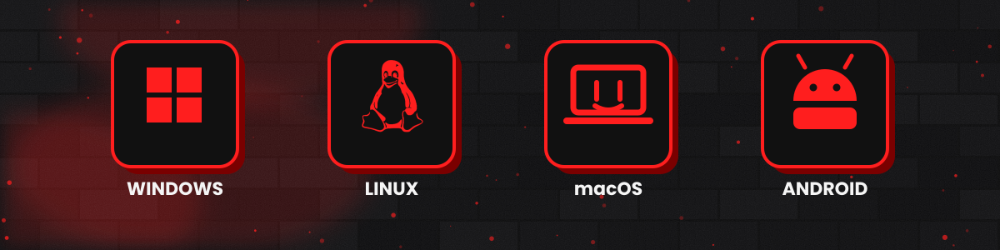

<!-- ───────────────────────── 01 · SOBRE ───────────────────────── -->

<b>E aí, bão fi?</b> Aqui é o Gus, ou <b>Massaru</b>, como muitos conhecem. Se você chegou até aqui, que loucura, em: me achou no meio de tanta gente. 
Sou estudante de <b>ADS</b> com muito orgulho e muito suor, atuo como <b>dev full stack web</b> e <b>game programmer</b>, e é incrível trabalhar nessa área. Viciante, só não é mais viciante que café. Eu <b>AMO</b> café. ☕

Hoje sou <b>Co-Fundador do GennisCode</b> e <b>Fundador de uma comunidade brasileira 100% focada em ensinar T.I. sem custos para todo o Brasil</b>. 
Também sou editor nas horas vagas (minha edição é bem <b>RUIM</b> e <b>DUVIDOSA</b>, mas sigo fazendo uns freelas por aí).

Se você está olhando meu perfil, ou é um amigo meu desocupado, ou gostou do que viu e achou ele espalhado por aí.

 

 

<!-- ───────────────────────── 02 · STACK ───────────────────────── -->

  

ver stack em texto

 

| Camada | Tecnologias |
| :--- | :--- |
| **Back-end** | NestJS · CodeIgniter · Meteor · JavaScript · Python |
| **Front-end** | HTML5 · CSS3 · JavaScript |
| **Banco de dados** | PostgreSQL |
| **Games & 3D** | Unreal Engine · C++ · Blender |
| **Design & Edição** | Photoshop |
| **Infra & Ambiente** | Linux · Debian · Ubuntu · Apache · VS Code |

 

<!-- ───────────────────────── 03 · ATIVIDADE ───────────────────────── -->

<picture>
  <source media="(prefers-color-scheme: dark)" srcset="https://raw.githubusercontent.com/Massarubash/Massarubash/pacman-output/galaga-contribution-graph-dark.svg?game=galaga">
  <source media="(prefers-color-scheme: light)" srcset="https://raw.githubusercontent.com/Massarubash/Massarubash/pacman-output/galaga-contribution-graph.svg?game=galaga">
  
</picture>

  

 

<!-- ───────────────────────── 04 · GENNISTEAM ───────────────────────── -->

 

 

Você deve estar se perguntando: <i>como um grupo de seis amigos, incluindo um japa "falsificado" e outros cinco entusiastas apaixonados por tecnologia, resolveu mudar o rumo da educação digital no Brasil?</i>

<b>A resposta é simples: inconformismo aliado a muita paixão.</b>

Nascemos da vontade genuína de ajudar as pessoas. Cansados de ver o conhecimento em T.I. trancado a sete chaves por mensalidades abusivas e promessas falsas, decidimos fazer diferente. A GennisTeam não é apenas um projeto: é um movimento. Somos a prova de que tecnologia de ponta, educação de qualidade e o sonho de construir uma carreira sólida não devem ser privilégios para poucos.

Nossa missão é direta e sem pausas: levar educação tecnológica <b>gratuita e acessível para o Brasil inteiro</b>, do zero absoluto até o mercado de trabalho, entregando certificação ao final da jornada. Aqui, qualquer pessoa, independentemente de onde veio ou de suas condições, pode dar o primeiro passo para transformar o próprio futuro.

 

 

Quer conhecer um pouquinho mais sobre a gente e nossas propostas?

<b>GennisCode</b> · <i>Aprenda, construa e compartilhe</i> 
Tecnologia é melhor quando é compartilhada. :)

<code>Projeto ainda em desenvolvimento :]</code>

 

<!-- ───────────────────────── COMUNIDADE ───────────────────────── -->

 

