<h3 align="center">🌴 Opa bão? 🌴</h3>

<b>ᯓ E aí, bão fi?</b> Aqui é o Gus, ou <b>Massaru</b>, como muitos conhecem. Se você está aqui, que loucura em, me achou no meio de tanta gente. 
Atualmente sou estudante de <b>ADS</b> com muito orgulho e muito suor. Atuo também como <b>dev full stack web</b> e <b>game programmer</b>. É incrível atuar nessa área, viciante, só não é mais viciante que café.. eu <b>AMO</b> café. ☕

<b>ᯓ Atualmente também sou editor</b>, minha edição é bem <b>RUIM</b> e <b>DUVIDOSA</b> e sigo fazendo uns freelancers aí. 
Se você está aqui olhando meu perfil, provavelmente ou você é um amigo meu desocupado que não tem nada para fazer, ou você é alguém que gostou do meu perfil e achou ele espalhado por aí. 
Lembre-se: <i>beba água, melhor uma pedrada na cabeça do que no rim</i> 👍

<h3 align="center">⟡ Stack ⟡</h3>

  
  
  
  
  
  
  
  
  
  
  
  
  
  
  
  
  
    
  
  
  
  
  
  
  
  
  
  
  
  
  
  
  

 

<picture>
  <source media="(prefers-color-scheme: dark)" srcset="https://raw.githubusercontent.com/Massarubash/Massarubash/pacman-output/galaga-contribution-graph-dark.svg?game=galaga">
  <source media="(prefers-color-scheme: light)" srcset="https://raw.githubusercontent.com/Massarubash/Massarubash/pacman-output/galaga-contribution-graph.svg?game=galaga">
  
</picture>

 

<h3 align="center">🌆 GennisTeam 🌆</h3>

 

<h3 align="center">˙𐃷˙ Sobre nós ˙𐃷˙</h3>

Você aí deve estar se perguntando: <i>como um grupo de seis amigos, incluindo um japa "falsificado" e outros cinco entusiastas apaixonados por tecnologia, resolveram mudar o rumo da educação digital no Brasil?</i>

<b>A resposta é simples: inconformismo aliado a muita paixão.</b>

Nós nascemos da vontade genuína de ajudar as pessoas. Cansados de ver o conhecimento em TI trancado a sete chaves por mensalidades abusivas e promessas falsas, decidimos fazer diferente. A GennisTeam não é apenas um projeto: é um movimento. Somos a prova de que tecnologia de ponta, educação de qualidade e o sonho de construir uma carreira sólida não devem ser privilégios para poucos.

Nossa missão é direta e sem pausas: levar educação tecnológica gratuita e acessível para o Brasil inteiro, do zero absoluto até o mercado de trabalho, entregando certificação ao final da jornada. Aqui, qualquer pessoa, independentemente de onde veio ou de suas condições, pode dar o primeiro passo para transformar o próprio futuro no que mais deseja.

<h3 align="center">Venha fazer parte da nossa família! ❤︎</h3>

Quer conhecer um pouquinho mais sobre a gente e nossas propostas? 

<b>GennisCode</b> · <i>Aprenda, construa e compartilhe</i> 
Tecnologia é melhor quando é compartilhada. :)

<code>Projeto ainda em desenvolvimento :]</code>

