

<picture>
  <source media="(prefers-reduced-motion: reduce)" srcset="assets/banners/banner-01-massaru.svg">
  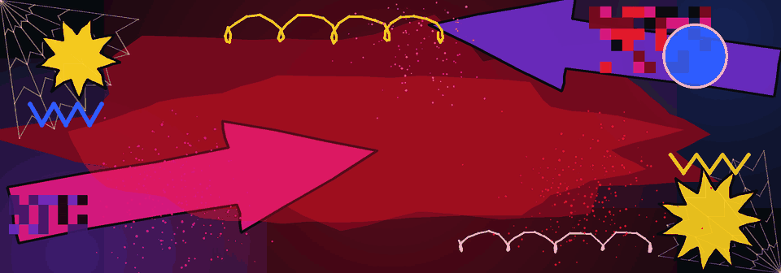
</picture>

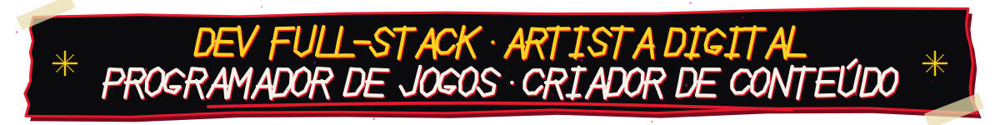

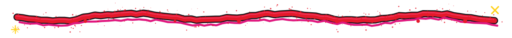

<!-- ═════════════════════════ SOBRE MIM ═════════════════════════ -->


<b>Oi, tudo bem? Prazer em te conhecer 👋</b> 
Eu sou o <b>Massaru</b>: um dev que desenha, um artista que programa e um apaixonado por tecnologia que ainda não decidiu qual é o personagem principal.

Atualmente estou cursando <b>Análise e Desenvolvimento de Sistemas (ADS)</b> e evoluindo como <b>Desenvolvedor Web Full Stack</b> e <b>Programador de Jogos</b>. 
Quando não estou brigando com o código, estou fazendo <b>arte digital</b> ou criando conteúdo de entretenimento na <b>Twitch</b>.

Tecnologia, programação, jogos e design são basicamente a minha personalidade. O resto são abas abertas no navegador. 
Fica por aqui, quebra umas coisas comigo e bora criar algo barulhento e colorido. 🎨

<!-- ✏️ EDITE: adicione mais sobre você aqui (curiosidades, jogos favoritos, no que você está trabalhando...) -->

<!-- ═════════════════════ INFORMAÇÕES PESSOAIS ═════════════════════ -->


<table align="center">
  <tr>
    <td align="right"></td>
    <td><b>Massaru</b> <!-- ✏️ adicione seu nome real ou outros apelidos --></td>
  </tr>
  <tr>
    <td align="right">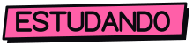</td>
    <td>Análise e Desenvolvimento de Sistemas (ADS)</td>
  </tr>
  <tr>
    <td align="right"></td>
    <td>Desenvolvimento Web Full Stack · Programação de Jogos</td>
  </tr>
  <tr>
    <td align="right"></td>
    <td>Programar · arte digital · criação de conteúdo na Twitch</td>
  </tr>
  <tr>
    <td align="right">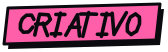</td>
    <td>Arte digital · design · jogos <!-- ✏️ adicione mais interesses criativos --></td>
  </tr>
  <tr>
    <td align="right">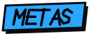</td>
    <td><i>✏️ Suas metas entram aqui.</i></td>
  </tr>
  <tr>
    <td align="right"></td>
    <td><i>✏️ O que você está aprendendo agora entra aqui.</i></td>
  </tr>
</table>

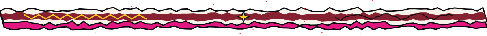

<!-- ═════════════════════ HABILIDADES / TECH STACK ═════════════════════ -->


<!-- ✏️ EDITE: esta é uma lista de ferramentas com as quais eu trabalho, não um gráfico de nível. Para adicionar ou remover etiquetas, edite a lista TECH em tools/generate-icons.py. -->

<table align="center">
  <tr>
    <td align="right"><b>Back-end e frameworks</b></td>
    <td>
      
      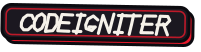
      
    </td>
  </tr>
  <tr>
    <td align="right"><b>Front-end</b></td>
    <td>
      
      
      
    </td>
  </tr>
  <tr>
    <td align="right"><b>Banco de dados</b></td>
    <td></td>
  </tr>
  <tr>
    <td align="right"><b>Linguagens</b></td>
    <td>
      
      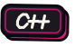
    </td>
  </tr>
  <tr>
    <td align="right"><b>Games e arte</b></td>
    <td>
      
      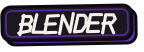
      
    </td>
  </tr>
  <tr>
    <td align="right"><b>Sistemas e ferramentas</b></td>
    <td>
      
      
      
      
      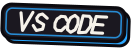
    </td>
  </tr>
</table>

<!-- ═════════════════════ INTERESSES EM DESENVOLVIMENTO ═════════════════════ -->

<table align="center">
  <tr>
    <td align="center" width="25%"> Jogar, criar e quebrar.</td>
    <td align="center" width="25%"> Full stack, da página ao banco de dados.</td>
    <td align="center" width="25%">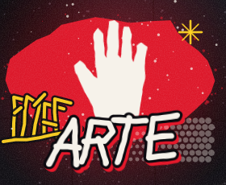 Arte digital, design e um pouco de caos.</td>
    <td align="center" width="25%"> Amigo do terminal. Debian, Ubuntu, Apache.</td>
  </tr>
</table>

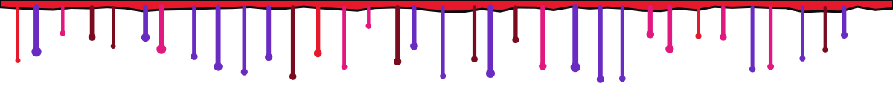

<!-- ═════════════════════ INSTAGRAM E REDES SOCIAIS ═════════════════════ -->

<!-- ✏️ Link do Instagram: mude o href abaixo se o perfil mudar -->

  
  <a href="https://twitch.tv/massadv_">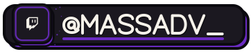</a>
  <!-- ✏️ Outras plataformas: copie uma linha acima e troque o link. Exemplo de botão:
  
  -->

<!-- ═════════════════════ ASSINATURA ═════════════════════ -->


