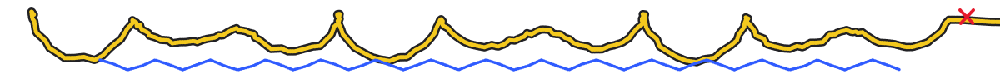
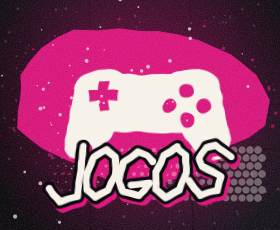
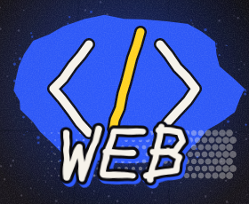
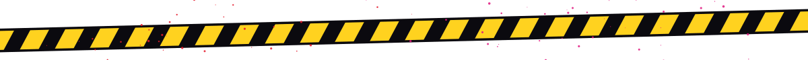
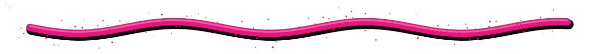
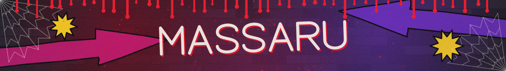

<!-- ═════════════════════════ SOBRE MIM ═════════════════════════ -->

<b>Opa bão?? 👋</b> 
𝘌𝘶 𝘴𝘰𝘶 𝘰 <b>Massaru</b>: 𝘊𝘰𝘯𝘩𝘦𝘤𝘪𝘥𝘰 𝘵𝘢𝘮𝘣𝘦́𝘮 𝘱𝘰𝘳 𝘢𝘭𝘨𝘶𝘯𝘴 𝘤𝘰𝘮𝘰 𝘎𝘶𝘴, 𝘰𝘶 𝘰 "𝘑𝘢𝘱𝘢" 𝘥𝘢 𝘛.𝘐, 𝘮𝘦𝘶 𝘰𝘣𝘫𝘦𝘵𝘪𝘷𝘰 𝘦́ 𝘴𝘪𝘮𝘱𝘭𝘦𝘴, 𝘦𝘯𝘴𝘪𝘯𝘢𝘳 𝘛.𝘐 𝘱𝘳𝘰 𝘉𝘳𝘢𝘴𝘪𝘭 𝘪𝘯𝘵𝘦𝘪𝘳𝘰 𝘴𝘦𝘮 𝘤𝘰𝘣𝘳𝘢𝘳 𝘯𝘦𝘯𝘩𝘶𝘮 𝘤𝘦𝘯𝘵𝘢𝘷𝘰 𝘴𝘦𝘲𝘶𝘦𝘳, 𝘦 𝘮𝘢𝘪𝘴 𝘥𝘰 𝘲𝘶𝘦 𝘪𝘴𝘴𝘰, 𝘴𝘦 𝘦𝘶 𝘤𝘰𝘯𝘴𝘦𝘨𝘶𝘪𝘳 𝘵𝘪𝘳𝘢𝘳 𝘶𝘮 𝘴𝘰𝘳𝘳𝘪𝘴𝘰 𝘴𝘦𝘶 𝘰𝘶 𝘶𝘮𝘢 𝘳𝘪𝘴𝘢𝘥𝘢 𝘤𝘰𝘮 𝘮𝘪𝘯𝘩𝘢𝘴 𝘳𝘦𝘴𝘦𝘯𝘩𝘢𝘴 𝘦 𝘭𝘰𝘶𝘤𝘶𝘳𝘢𝘴 𝘱𝘰𝘥𝘦 𝘵𝘦𝘳 𝘤𝘦𝘳𝘵𝘦𝘻𝘢 𝘲𝘶𝘦 𝘪𝘴𝘴𝘰 𝘷𝘢𝘪 𝘧𝘢𝘻𝘦𝘳 𝘮𝘦𝘶 𝘥𝘪𝘢 𝘱𝘦𝘭𝘰 𝘳𝘦𝘴𝘵𝘰 𝘥𝘢 𝘴𝘦𝘮𝘢𝘯𝘢!

𝘈𝘵𝘶𝘢𝘭𝘮𝘦𝘯𝘵𝘦 𝘦𝘴𝘵𝘰𝘶 𝘤𝘶𝘳𝘴𝘢𝘯𝘥𝘰 <b>Análise e Desenvolvimento de Sistemas (ADS)</b> 𝘦 𝘴𝘪𝘨𝘰 𝘦𝘷𝘰𝘭𝘶𝘪𝘯𝘥𝘰 𝘱𝘳𝘪𝘯𝘤𝘪𝘱𝘢𝘭𝘮𝘦𝘯𝘵𝘦 𝘤𝘰𝘮𝘰 <b>Desenvolvedor Web Full Stack</b>, 𝘵𝘢𝘮𝘣𝘦́𝘮 𝘦𝘶 𝘮𝘦𝘹𝘰 𝘤𝘰𝘮 𝘳𝘰𝘵𝘦𝘪𝘳𝘪𝘻𝘢𝘤̧𝘢̃𝘰 𝘦 𝘤𝘳𝘪𝘢𝘤̧𝘢̃𝘰 𝘥𝘦 <b>Jogos Independentes/Tradução de Jogos</b>. 
  

𝘌𝘶 𝘵𝘢𝘮𝘣𝘦́𝘮 𝘧𝘢𝘤̧𝘰 𝘧𝘳𝘦𝘦𝘭𝘢𝘯𝘤𝘦𝘳 𝘤𝘰𝘮𝘰 𝘴𝘶𝘱𝘰𝘳𝘵𝘦 𝘵𝘦́𝘤𝘯𝘪𝘤𝘰 𝘥𝘦 𝘧𝘰𝘳𝘮𝘢 𝘪𝘯𝘥𝘦𝘱𝘦𝘯𝘥𝘦𝘯𝘵𝘦, 𝘦𝘶 curto arrumar 𝘦 𝘢𝘵𝘦́ 𝘧𝘢𝘤̧𝘰 𝘮𝘢𝘯𝘶𝘵𝘦𝘯𝘤̧𝘢̃𝘰 𝘥𝘰𝘴 𝘮𝘦𝘶𝘴 𝘱𝘳𝘰́𝘱𝘳𝘪𝘰𝘴 𝘦𝘭𝘦𝘵𝘳𝘰̂𝘯𝘪𝘤𝘰𝘴, principalmente 𝘥𝘦 clientes amigos meus que gostam e confiam no meu trabalho, 𝘦𝘶 𝘤𝘰𝘣𝘳𝘰 𝘢𝘱𝘦𝘯𝘢𝘴 1 𝘤𝘦𝘯𝘵𝘢𝘷𝘰 𝘦 𝘶𝘮 𝘱𝘢𝘴𝘵𝘦𝘭 (𝒑𝒐𝒅𝒆 𝒔𝒆𝒓 𝒖𝒎 𝒄𝒂𝒍𝒅𝒐 𝒅𝒆 𝒄𝒂𝒏𝒂 𝒈𝒆𝒍𝒂𝒅𝒊𝒏 𝒕𝒂𝒎𝒃𝒆́𝒎). 𝘌𝘶 𝘨𝘰𝘴𝘵𝘰 𝘮𝘶𝘪𝘵𝘰 𝘥𝘦 𝘢𝘫𝘶𝘥𝘢𝘳 𝘱𝘦𝘴𝘴𝘰𝘢𝘴, 𝘱𝘳𝘪𝘯𝘤𝘪𝘱𝘢𝘭𝘮𝘦𝘯𝘵𝘦 𝘲𝘶𝘢𝘯𝘥𝘰 𝘴𝘦 𝘵𝘳𝘢𝘵𝘢 𝘥𝘦 𝘢𝘱𝘳𝘦𝘯𝘥𝘪𝘻𝘢𝘥𝘰, 𝘢 𝘮𝘢𝘪𝘰𝘳𝘪𝘢 𝘥𝘢𝘴 𝘷𝘦𝘻𝘦𝘴 𝘦𝘶 𝘵𝘰̂ 𝘱𝘰𝘳 𝘢𝘪 𝘢𝘫𝘶𝘥𝘢𝘯𝘥𝘰 𝘨𝘦𝘳𝘢𝘭 𝘢 𝘤𝘰𝘮𝘰 𝘳𝘦𝘴𝘰𝘭𝘷𝘦𝘳 𝘱𝘳𝘰𝘣𝘭𝘦𝘮𝘢𝘴 𝘲𝘶𝘦 𝘦𝘯𝘷𝘰𝘭𝘷𝘦𝘮 𝘱𝘳𝘰𝘨𝘳𝘢𝘮𝘢𝘤̧𝘢̃𝘰 𝘦 𝘴𝘶𝘱𝘰𝘳𝘵𝘦 𝘵𝘦́𝘤𝘯𝘪𝘤𝘰 𝘵𝘢𝘮𝘣𝘦́𝘮, 𝘴𝘪𝘮, 𝘦𝘶 𝘢𝘫𝘶𝘥𝘰 𝘢 𝘷𝘰𝘤𝘦̂ 𝘢 𝘤𝘰𝘮𝘰 𝘢𝘳𝘳𝘶𝘮𝘢𝘳 𝘴𝘦𝘶 𝘯𝘰𝘵𝘦𝘣𝘰𝘰𝘬 𝑺𝑬𝑴 𝑩𝑶𝑻𝑨𝑹 𝑭𝑶𝑮𝑶 𝑵𝑨 𝑪𝑨𝑺𝑨 𝑪𝑶𝑴 𝑽𝑶𝑪𝑬̂ 𝑱𝑼𝑵𝑻𝑶𝑲𝑲𝑲𝑲 
  

| Quando não estou ensinando e estudando T.I, provavelmente estou dormindo <b>MUITO</b> ou criando conteúdo esquisito pra vocês na <b> Roxinha (Twitch) e no Youtobas</b>. ˙𐃷˙

<!-- ✏️ EDITE: adicione mais sobre você aqui (curiosidades, jogos favoritos, no que você está trabalhando...) -->

<!-- ═════════════════════ HABILIDADES / TECH STACK ═════════════════════ -->

<!-- ✏️ EDITE: esta é uma lista de ferramentas com as quais eu trabalho, não um gráfico de nível. Para adicionar ou remover etiquetas, edite a lista TECH em tools/generate-icons.py. -->

<table align="center">
  
 
 

<!-- ═════════════════════ INTERESSES EM DESENVOLVIMENTO ═════════════════════ -->

<table align="center">
  <tr>
    <td align="center" width="25%"> Jogar, criar e quebrar.</td>
    <td align="center" width="25%"> Full stack, da página ao banco de dados.</td>
    <td align="center" width="25%"> Arte digital, design e um pouco de caos.</td>
    <td align="center" width="25%"> Amigo do terminal. Debian, Ubuntu, Apache.</td>
  </tr>
</table>

<!-- ═════════════════════ INSTAGRAM E REDES SOCIAIS ═════════════════════ -->

<!-- ✏️ Link do Instagram: mude o href abaixo se o perfil mudar -->

  
  
  <!-- ✏️ Outras plataformas: copie uma linha acima e troque o link. Exemplo de botão:
  
  -->

<!-- ═════════════════════ ASSINATURA ═════════════════════ -->

